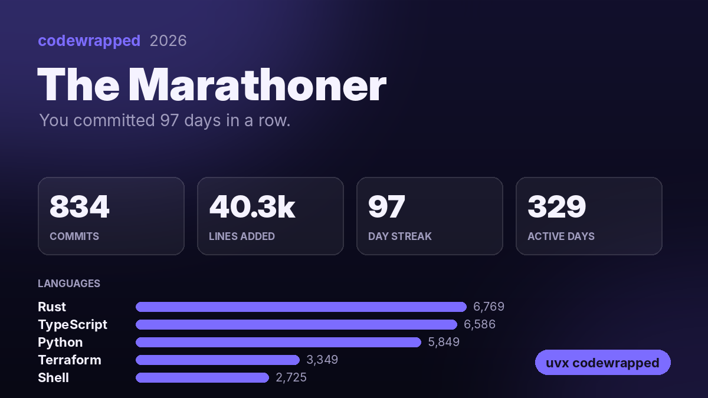

<h1 align="center">codewrapped</h1>

<p align="center"><b>Spotify Wrapped for your code.</b><br>
Your year in commits, from <i>every</i> git repo on your machine, work and personal, public and private. Plus a card to share.</p>

<p align="center">
  <a href="https://pypi.org/project/codewrapped/"></a>
  <a href="https://github.com/ArkaKhorchidian/codewrapped/actions/workflows/ci.yml"></a>
  
  <a href="LICENSE"></a>
</p>

```bash
uvx codewrapped ~/code        # or: pipx run codewrapped ~/code
```

<p align="center">
  
</p>

<p align="center"></p>

<sub>Demo and card generated from synthetic repositories.</sub>

## Why another Wrapped?

GitHub-based year-in-review tools only see what's on GitHub. Your year also lives in your
employer's GitLab, in private repos, and in side projects that never got pushed. codewrapped
reads the git history already on your disk, so it sees all of it, and none of it leaves your
machine.

## What you get

- **Commits, lines added and deleted, active days, longest streak**, deduplicated across clones and forks
- **Your languages** by lines written (lockfiles, `node_modules`, minified and generated files are ignored)
- **Your rhythm**: the hour and weekday you code best, your busiest day and month, your latest-night commit
- **Your commit messages**: your favorite word, how many were fixes, your shortest message
- **Your developer personality**: The Night Owl, The Marathoner, The Refactorer, The Weekend Warrior, The Polyglot, ...
- **A 1200×675 share card**, sized for X, LinkedIn and Slack previews

## Private by design

- It reads your local git history. No API calls, no tokens, no network.
- **The card never shows repo names or code**, so private work projects stay private. It shows your numbers and languages only.
- Repo names appear in your terminal summary, which only you see.

## Options

```bash
codewrapped                         # repos under the current folder
codewrapped ~/code ~/work           # search several places
codewrapped --year 2025
codewrapped --author me@work.com --author me@personal.dev   # all the emails you commit with
codewrapped --everyone              # a whole team's wrapped, for one repo
codewrapped --no-anim               # just the summary
codewrapped --card wrapped.png      # or --no-card
```

By default it counts commits matching the `user.email` / `user.name` in your git config (global and per-repo).
If you've committed under several emails, pass each with `--author`.

## License

MIT. Bundles the [Inter](https://github.com/rsms/inter) typeface under the SIL Open Font License.
